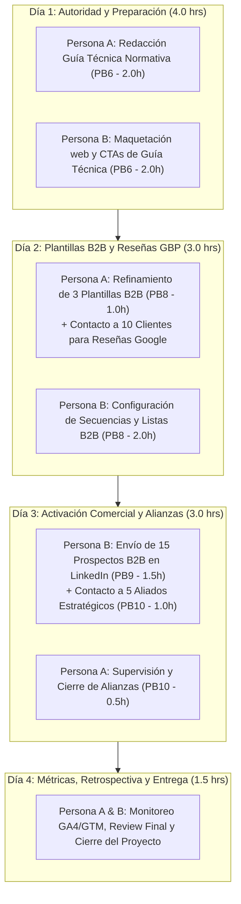

# Informe Ejecutivo y Sprint Review: Estado de Avances, PB5 Consolidado y Hoja de Ruta de Cierre B2B
**Legado Ambiental S.A. de C.V.**  
*Documento de Comunicación Interna para el Equipo de Proyecto y Dirección General*  
**Código de Documento:** `INF-LA-SR-2026-006`  
**Fecha de Emisión:** Octubre 2026  
**Versión:** 2.0 (Consolidada tras Culminación de PB5 y Hardening UI/UX)  
**Clasificación:** Ceremonia de Sprint Review, Orientación Técnica & Plan de Acción Inmediato  

---

## 1. Resumen Ejecutivo y Dictamen del Sprint Review

El presente informe formaliza la **Sprint Review** del proyecto de **Optimización UI/UX, Embudo B2B y Presencia Digital** de **Legado Ambiental**, contrastando las metas proyectadas en el [Plan de Trabajo y Arquitectura UI_UX - Legado Ambiental.md](file:///home/andrew/Development/workspace-legado-ambiental/website-legado/markdown/Plan%20de%20Trabajo%20y%20Arquitectura%20UI_UX%20-%20Legado%20Ambiental.md) contra los entregables tangibles en el repositorio al día de hoy.

### Balance de Desempeño General:
1. **Progreso General del Proyecto:** **~78% completado** (31 de 40 horas efectivas ejecutadas y validadas con pruebas de cero regresión).
2. **Sprint 1 (Fundamentos y Presencia Local - 20 hrs):** **100% CONCLUIDO Y OPERATIVO**.
3. **PB5 (Micro-Landings de Servicios y Conversión On-Site - 6.0 hrs):** **100% CONCLUIDO** a través de 5 módulos desplegados en producción ([services.html](file:///home/andrew/Development/workspace-legado-ambiental/website-legado/services_overview/services.html) y [contact_faq.html](file:///home/andrew/Development/workspace-legado-ambiental/website-legado/faq/contact_faq.html)).
4. **Infraestructura de Estabilidad y Calidad Web:** Se erradicaron bloqueos de scripts de animaciones (`AOS`), se blindó la carga de páginas eliminando pantallas blancas, y se optimizó el controlador AJAX de contacto para entrega garantizada por FormSubmit.
5. **Estado de lo Faltante:** El embudo digital y las herramientas de conversión están 100% listos. Lo que resta para completar la ventana de trabajo se enfoca en **autoridad de contenido (PB6)**, **materiales de venta en frío (PB8)** y **activación comercial directa (PB9-10 + Campaña de Reseñas en Google Maps)**.

---

## 2. Matriz Comparativa del Backlog: Planificado vs. Ejecutado

| ID Tarea | Descripción según Plan | Horas Est. | Asignación | Estado Actual | Entregables y Evidencia Técnica |
| :---: | :--- | :---: | :---: | :---: | :--- |
| **PB1** | Rediseño de Hero Section JTBD | 3.0 h | Persona A: 1.0h<br>Persona B: 2.0h | **100% CONCLUIDO** | [home.html](file:///home/andrew/Development/workspace-legado-ambiental/website-legado/home.html) con propuesta de valor orientada a dolores, Trust Banner normativo (`NOM-052`, `STPS`) e `i18n.js`. |
| **PB2** | Integración de CTAs Estratégicos | 3.0 h | Persona B: 3.0h | **100% CONCLUIDO** | CTAs duales en cabeceras y patrón híbrido móvil: **Sticky Mobile CTA Bar** ("Cotizar Proyecto") + **FAB WhatsApp** flotante. |
| **PB3** | Simplificación de Formularios | 3.0 h | Persona B: 3.0h | **100% CONCLUIDO** | Formulario de 6 campos en [contact_faq.html](file:///home/andrew/Development/workspace-legado-ambiental/website-legado/faq/contact_faq.html), campo trampa Honeypot, feedback Toast y controlador AJAX optimizado. |
| **PB4** | Google Business Profile (SEO Local) | 3.0 h | Persona A: 1.0h<br>Persona B: 2.0h | **100% CONCLUIDO** | Ficha verificada por Google en vivo (199+ interacciones), 11 fotografías HD en 4:3 (1200x896 px), demo 3D volumétrico y suite de códigos QR. |
| **PB7** | Optimización Portafolio PDF & QR | 3.0 h | Persona A: 1.0h<br>Persona B: 2.0h | **100% CONCLUIDO** | Portafolio editorial tamaño Carta (8.5x11 in) con `@media print`, tokens institucionales ([Curricula_Legado_Ambiental_2026_v2.html](file:///home/andrew/Development/workspace-legado-ambiental/website-legado/assets/docs/Curricula_Legado_Ambiental_2026_v2.html)) y credencial de mostrador. |
| **PB12** | Configuración Analítica (GA4 / GTM) | 3.0 h | Persona B: 3.0h | **100% CONCLUIDO** | Tag `G-1MLGHB4E6G` en 8 páginas HTML, cabeceras CSP actualizadas, 8 eventos de conversión en `assets/js/analytics.js`. |
| **PB5** | Landing Pages de Servicios Específicos | 6.0 h | Persona A: 1.0h<br>Persona B: 5.0h | **100% CONCLUIDO** | Micro-landings con router semántico (`#ambiental`, `#construccion`, `#topografia`, `#seguridad-hidraulica`), 4 cabeceras de autoridad técnica, erradicación de Google Forms y auto-selección en formulario. |
| **PB6** | Contenido Técnico Normativo (STPS/NOM) | 4.0 h | Persona A: 2.0h<br>Persona B: 2.0h | **PENDIENTE (Sprint 2)** | Insumos normativos integrados en Hero y servicios; **pendiente redacción y publicación del artículo editorial extendido**. |
| **PB8** | Plantillas y Preparación B2B | 3.0 h | Persona A: 1.0h<br>Persona B: 2.0h | **PARCIAL (Sprint 2)** | Perfil de LinkedIn integrado en todo el sitio web y Schema.org; **pendiente redacción formal de las 3 plantillas de contacto en frío**. |
| **PB9-10**| Prospección Directa y Red de Alianzas | 3.0 h | Persona A: 0.5h<br>Persona B: 2.5h | **PENDIENTE (Operativo)** | Embudo listo; **pendiente envío de los primeros 15 contactos cualificados y vinculación con 5 aliados estratégicos**. |
| **Prueb.**| Pruebas de Embudo y Cierre | 1.5 h | Persona B: 1.5h | **100% CONCLUIDO** | Auditoría i18n automatizada (449/449 claves validadas), verificación E2E de enlaces y formularios, estabilidad visual blindada. |
| **Cer.** | Ceremonias Ágiles de Sprints 1 y 2 | 4.5 h | Persona A: 3.5h<br>Persona B: 1.0h | **EN CURSO** | Sprint 1 cerrado, Sprint Review intermedia formalizada en este informe; cierre final agendado para entrega operativa. |
| **PB13** | Google Ads Local (Pilar 6 - Post-Proyecto)| — | Dirección | **POSPUESTO FORMAL** | Dictamen técnico y financiero emitido ([Dictamen_Credito_Google_Ads_7000_MXN.pdf](file:///home/andrew/Development/workspace-legado-ambiental/website-legado/assets/docs/Dictamen_Credito_Google_Ads_7000_MXN.pdf)). Ahorro de $8,120 MXN netos para cuidar liquidez y priorizar canales orgánicos. |

---

## 3. Detalle de los Avances Técnicos y de Negocio Logrados

### 3.1 Culminación Integral de PB5: Micro-Landings y Embudo On-Site
* **Router Semántico y Deep-Linking:** Implementación de navegación por pestañas con identificadores limpios (`#ambiental`, `#construccion`, `#topografia`, `#seguridad-hidraulica`) y sincronización bidireccional entre URL, selector táctil móvil y botones de escritorio en [services.html](file:///home/andrew/Development/workspace-legado-ambiental/website-legado/services_overview/services.html).
* **Cabeceras de Autoridad Técnica por Especialidad:** 4 cabeceras destacadas con propuesta de valor B2B dirigida a resolver dolores normativos (multas PROFEPA/SEMARNAT, bitácora DRO, tiempos de entrega topográfica en 24-48h, cumplimiento PTAR).
* **0% Fuga de Tráfico (Eliminación Total de Google Forms externos):** Sustitución de los formularios externos por conversión on-site. Las 15 tarjetas de servicio ahora dirigen al usuario a `contact_faq.html?service=[slug]`, donde el sistema activa automáticamente la pestaña de contacto, selecciona la disciplina y realiza un desplazamiento suave (*smooth scroll*) al formulario.
* **Integración Institucional de LinkedIn:** Enlace oficial unificado ([linkedin.com/in/legado-ambiental-mx](https://www.linkedin.com/in/legado-ambiental-mx)) en pie de página de las 8 páginas, tarjeta de contacto y metadatos estructurados Schema.org (`sameAs`).

### 3.2 Consolidación del Pilar 5 (Google Business Profile)
* Perfil verificado formalmente por Google en San Juan del Río / Querétaro / Bajío con panel administrativo y más de 199 interacciones registradas.
* Catálogo de 11 fotografías HD en proporción 4:3 (1200x896 px) y video demostrativo de 20 segundos de volumetría y curvas de nivel 3D.
* Suite de códigos QR de alta densidad y credencial interactiva para recepción de clientes ([tarjeta-qr-legadoambiental.html](file:///home/andrew/Development/workspace-legado-ambiental/website-legado/assets/images/qr/tarjeta-qr-legadoambiental.html)).

### 3.3 Medición B2B y Blindaje de Rendimiento (GA4 + CRO)
* Instrumentación en `assets/js/analytics.js` con telemetría de eventos clave: clics en WhatsApp, envíos exitosos de formulario, selección de servicios y profundidad de scroll.
* Hardening de seguridad en enlaces externos con `rel="noopener noreferrer"`.
* Eliminación definitiva de dependencias innecesarias de animación (`AOS`) y optimización de carga para evitar parpadeos y retrasos de renderizado.

---

## 4. Orientación, Ejemplos y Guías de Ejecución para los Puntos Restantes

Para concluir con éxito las tareas pendientes del Sprint 2 y activar la captación de los primeros 100 prospectos, el equipo debe seguir las siguientes pautas técnicas y comerciales:

---

### 4.1 Tarea PB6: Artículo Técnico Normativo (STPS / SEMARNAT)
* **Objetivo:** Generar autoridad técnica y atraer tráfico orgánico calificado (directores de obra y responsables ambientales) que buscan resolver una exigencia regulatoria inminente.
* **Asignación:** Persona A (2.0h redacción del contenido técnico) + Persona B (2.0h maquetación web y enlaces de conversión).
* **Ubicación recomendada:** Publicar como recurso técnico en el sitio web (ej. `resources/guia-normativa-obras-bajio.html` o integrado en una sección editorial destacada dentro de `services.html` / `faq/contact_faq.html`).

#### Propuesta Editorial Concreta para PB6:
* **Título Propuesto:**  
  *“Guía de Cumplimiento Ambiental y Laboral en Obras Civiles e Industriales en el Bajío: Evitando Clausuras de SEMARNAT y Sanciones de la STPS (Edición 2026)”*
* **Estructura del Artículo (Esquema de Contenido):**
  1. **Introducción:** Los 3 errores más comunes en trámites ambientales al arrancar una nave o desarrollo en Querétaro, Guanajuato y Estado de México.
  2. **Bloque SEMARNAT / PROFEPA (Impacto Ambiental y Residuos):**
     * ¿Cuándo es obligatoria una MIA (Manifestación de Impacto Ambiental) vs. un Informe Preventivo?
     * Clasificación CRETI y manejo de residuos peligrosos (NOM-052-SEMARNAT).
     * Checklist rápido para evitar suspensiones provisionales de obra.
  3. **Bloque STPS / Seguridad en Obra:**
     * Normativa NOM-031-STPS (Construcción) y NOM-019-STPS (Comisiones de Seguridad e Higiene).
     * Requisito de constancias laborales DC-3 emitidas por Agentes Capacitadores Externos certificados.
  4. **Bloque Topografía y DRO:**
     * Importancia de la georreferenciación GPS RTK para evitar invasiones de linderos y problemas catastrales.
     * Respaldo legal mediante firma y bitácora de Director Responsable de Obra (DRO).
  5. **Llamado a la Acción (CTA de Cierre):**
     * Banner destacado: *“¿Tiene una inspección en puerta o necesita tramitar su dictamen ambiental? Agende una revisión técnica preliminar sin costo con nuestros ingenieros.”*
     * Botón 1: *“Solicitar Asesoría Normativa”* (enlace a `../faq/contact_faq.html?service=ambiental`).
     * Botón 2: *“Consultar por WhatsApp”* con mensaje precargado de urgencia normativa.

---

### 4.2 Tarea PB8: Las 3 Plantillas de Prospección B2B en Frío
* **Objetivo:** Disponer de mensajes de aproximación consultiva de alta conversión para LinkedIn y correo corporativo, orientados a dolores específicos y sin sonar como publicidad invasiva.
* **Asignación:** Persona A (1.0h refinamiento de tono y terminología) + Persona B (2.0h configuración de perfiles y personalización).

#### Plantilla 1: Para Directores de Obra / Superintendentes de Construcción
* **Enfoque de Dolor:** Retrasos en entrega de planos, falta de firma DRO y problemas con linderos en sitio.
* **Mensaje:**
```text
Asunto: Control topográfico y bitácora DRO sin demoras para sus frentes de obra en [Ciudad/Zona]

Estimado/a [Nombre del Director de Obra],

Observo el avance constructivo que lideran en [Nombre de la Empresa Constructora]. En etapas críticas de cimentación y terracerías, uno de los mayores dolores de cabeza para la superintendencia suele ser el desfase en las entregas de brigadas topográficas o demoras en la firma de bitácoras por parte del DRO.

En Legado Ambiental entregamos memorias topográficas con tecnología GPS RTK y drones LiDAR con planos ejecutivos en 24 a 48 horas, además de respaldo formal con Director Responsable de Obra colegiado en el Bajío y Estado de México.

¿Tendría 5 minutos esta semana para una llamada rápida y evaluar si podemos respaldar sus frentes de trabajo actuales o su próximo proyecto?

Le comparto nuestro portafolio técnico y credenciales aquí: [ENLACE A PORTAFOLIO PDF / WEB]

Saludos cordiales,
[Nombre del Remitente]
Legado Ambiental S.A. de C.V.
WhatsApp directo: +52 55 8367 1036
```

#### Plantilla 2: Para Gerentes de Proyecto / Desarrolladores Inmobiliarios
* **Enfoque de Dolor:** Riesgo de multas o clausuras por falta de permisos ambientales (MIA / PROFEPA) y saneamiento PTAR.
* **Mensaje:**
```text
Asunto: Blindaje normativo ambiental y dictámenes para [Nombre del Proyecto o Desarrollo]

Hola [Nombre del Gerente], un gusto saludarte.

En el desarrollo de proyectos industriales y residenciales en el corredor del Bajío, los tiempos de resolución ante dependencias ambientales (SEMARNAT, PROFEPA y dependencias estatales) suelen ser un cuello de botella crítico para la viabilidad de la inversión.

En Legado Ambiental contamos con más de 10 años de experiencia técnica elaborando Manifestaciones de Impacto Ambiental (MIA), estudios de daño y proyectos ejecutivos de tratamiento de aguas residuales (PTAR) bajo la NOM-001. Nuestro equipo diseña expedientes técnicos rigurosos que aceleran la dictaminación y evitan observaciones o clausuras costosas.

Me gustaría consultarle: ¿cuentan actualmente con proyectos en fase de trámite normativo o diseño hidrosanitario donde podamos asistirlos con un diagnóstico preliminar?

Quedo a sus órdenes y le comparto nuestros servicios especializados: https://www.legadoambiental.com.mx/services_overview/services.html#ambiental

Atentamente,
[Nombre del Remitente]
Legado Ambiental S.A. de C.V.
```

#### Plantilla 3: Para Responsables de Seguridad, Higiene y Medio Ambiente (EHS / HSE)
* **Enfoque de Dolor:** Auditorías de la STPS, carpetas normativas incompletas y falta de constancias DC-3 válidas.
* **Mensaje:**
```text
Asunto: Cumplimiento STPS, carpetas NOM-019/031 y constancias DC-3 para [Nombre de la Empresa]

Estimado/a [Nombre del Coordinador EHS],

Con la reciente intensificación en las inspecciones laborales y de seguridad en centros de trabajo y frentes de obra, mantener los expedientes STPS al 100% de cumplimiento es indispensable para prevenir sanciones administrativas.

En Legado Ambiental somos Agentes Capacitadores Externos certificados ante la Secretaría del Trabajo (STPS). Capacitamos a su personal técnico y operativo en sitio o de forma híbrida, emitiendo constancias de competencias laborales DC-3 con validez oficial, además de estructurar sus carpetas de comisiones de seguridad (NOM-019-STPS) y planes de emergencia.

¿Tienen programadas capacitaciones o auditorías de seguridad para este trimestre donde podamos apoyarle con una cotización adaptada a su plantilla?

Puede consultar el detalle de nuestros módulos de seguridad aquí: https://www.legadoambiental.com.mx/services_overview/services.html#seguridad-hidraulica

Un cordial saludo,
[Nombre del Remitente]
Legado Ambiental S.A. de C.V.
```

---

### 4.3 Tarea PB9 y PB10: Prospección Activa y Red de Alianzas Comerciales
* **Objetivo:** Salir al mercado con el embudo digital listo para generar las primeras 15 oportunidades comerciales directas y 5 alianzas estratégicas de referencia cruzada.
* **Asignación:** Persona A (0.5h aprobación de lista) + Persona B (2.5h envíos, seguimiento y registro de contactos).

#### Protocolo de Prospección Directa (PB9 - Meta: 15 Empresas Calificadas):
1. **Filtro de Selección de Prospectos (LinkedIn Sales Navigator / Búsqueda Orgánica):**
   * **Ubicaciones:** Querétaro, San Juan del Río, Celaya, Toluca, Cuautitlán Izcalli, Tlalnepantla.
   * **Cargos objetivo:** *Superintendente de Construcción*, *Director Responsable de Obra*, *Gerente de Proyectos*, *Director de Operaciones*, *Coordinador EHS*.
   * **Industrias:** Construcción pesada, naves industriales, desarrollos de vivienda, infraestructura vial.
2. **Cadencia de Contacto:**
   * **Día 1:** Conexión personalizada en LinkedIn con nota breve de valor (sin venta dura).
   * **Día 3 (al aceptar):** Envío de Plantilla 1, 2 o 3 según el perfil, adjuntando enlace a micro-landing de servicio específico o portafolio.
   * **Día 7 (sin respuesta):** Mensaje de cortesía ofreciendo el artículo técnico normativo (PB6) o una revisión preliminar sin costo.
3. **Registro en Hoja de Control de Oportunidades:** Registrar Empresa, Contacto, Cargo, Teléfono/LinkedIn, Servicio de Interés y Fecha de Siguiente Acción.

#### Protocolo de Red de Alianzas Estratégicas (PB10 - Meta: 5 Aliados Clave):
* **Tipología de Aliados a Contactar:**
  1. *Laboratorios de Mecánica de Suelos:* Requieren con frecuencia topógrafos de confianza para levantar sondeos y niveles.
  2. *Despachos de Cálculo Estructural:* Necesitan levantamientos geodésicos preliminares precisos para modelar proyectos.
  3. *Contratistas de Pavimentación / Terracerías:* Requieren topografía de control geométrico y cálculo de volúmenes de corte/terraplén.
  4. *Gestores de Licencias Municipales:* Necesitan memorias de impacto ambiental y dictámenes de agua para autorizar construcciones.
* **Propuesta de Alianza (Comisión / Reciprocidad de Proyectos):**
  * Presentar a Legado Ambiental como su brazo técnico especializado para las disciplinas que ellos no cubren.
  * Esquema de comisión por referencia o intercambio formal de cartera de clientes.

---

### 4.4 Campaña Sistemática de Recolección de Reseñas en Google Maps
* **Objetivo Inmediato:** Obtener de **5 a 8 reseñas verificadas de 5 estrellas** con texto explicativo en los próximos 7 días naturales para consolidar la prueba social del perfil de Google Business Profile.
* **Responsable Principal:** Persona A (Estratega / Dirección Comercial) mediante contacto con clientes históricos y directores de confianza.

#### Proceso Operativo Paso a Paso:
1. **Identificar a los 10 Clientes Históricos Clave:**
   * Seleccionar 10 contratistas, superintendentes o empresarios a quienes Legado Ambiental les haya entregado exitosamente proyectos en el último año.
2. **Obtener el Enlace Oficial Directo de Reseña:**
   * Extraer la URL corta desde el panel de Google Business: `https://g.page/r/[CODIGO_OFICIAL]/review` (o utilizando el código QR generado en [tarjeta-qr-legadoambiental.html](file:///home/andrew/Development/workspace-legado-ambiental/website-legado/assets/images/qr/tarjeta-qr-legadoambiental.html)).
3. **Envío del Mensaje por WhatsApp Directo (Personalizado):**

```text
Estimado/a [Nombre del Cliente], le saluda con gusto [Nombre] de Legado Ambiental.

Espero que se encuentre excelente. Recordamos con mucho gusto la colaboración con su equipo en [nombre del proyecto o servicio, ej. el levantamiento topográfico y control de obra en San Juan del Río].

Actualmente estamos actualizando nuestro perfil oficial verificado en Google Maps. Para nuestro equipo de ingenieros sería un enorme apoyo si pudiera regalarnos un breve comentario de 1 minuto sobre su experiencia de trabajo con nosotros.

Puede dejar su reseña directamente desde su celular dando clic aquí:
👉 [ENLACE CORTO DE RESEÑAS DE GOOGLE MAPS]

¡Agradecemos mucho su confianza y apoyo de siempre!
```

4. **Protocolo de Respuesta SEO a Reseñas Recibidas:**
   * Responder a cada reseña en menos de 24 horas incorporando de forma natural el servicio y la ubicación (ej. *“Muchas gracias por la confianza, Ing. [Apellido]. En Legado Ambiental nos alegra haber respaldado su proyecto de obra civil en Querétaro con la mayor precisión topográfica. ¡Seguimos a sus órdenes!”*).

---

## 5. Plan de Siguientes Pasos, Cronograma y Acciones Concretas

Para dar cierre definitivo al plan de 40 horas y activar la generación de prospectos, se establece el siguiente cronograma de ejecución para las 9.0 horas restantes:



### Detalle de Asignaciones y Horas Restantes:

| Día de Ejecución | Tarea | Actividad Concreta | Responsable | Horas |
| :---: | :---: | :--- | :---: | :---: |
| **Día 1** | **PB6** | Redactar el contenido editorial de la guía técnica sobre cumplimiento STPS/SEMARNAT. | Persona A | 2.0 h |
| **Día 1** | **PB6** | Maquetar el artículo en la web con botones de cotización y WhatsApp precargado. | Persona B | 2.0 h |
| **Día 2** | **PB8** | Adaptar y aprobar las 3 plantillas de prospección por perfil de tomador de decisión. | Persona A | 1.0 h |
| **Día 2** | **PB8** | Identificar los primeros 15 prospectos calificados en Querétaro y el Bajío. | Persona B | 2.0 h |
| **Día 2** | **Campaña GBP**| Enviar solicitudes de reseña vía WhatsApp a los 10 clientes clave históricos. | Persona A | — |
| **Día 3** | **PB9** | Enviar los 15 mensajes de aproximación en frío por LinkedIn. | Persona B | 1.5 h |
| **Día 3** | **PB10** | Contactar a los primeros 5 aliados estratégicos (laboratorios y calculistas). | Persona A / B | 1.5 h |
| **Día 4** | **Cierre** | Verificar eventos de conversión en GA4, analizar respuestas y cerrar Sprint 2. | Persona A / B | 1.5 h |
| **Total Horas Restantes** | | **Cierre de Ciclo del Proyecto** | | **11.5 h** |

---

## 6. Definición de Terminado (Definition of Done - DoD) para el Cierre Total

El proyecto alcanzará su estado de entrega formal y exitosa cuando se cumplan los siguientes criterios objetivos:
1. [x] **Plataforma Web:** Ecosistema responsive, bilingüe, sin fugas a formularios externos y con router semántico operativo (Completado en PB5).
2. [x] **SEO Local:** Google Business Profile verificado y suite QR institucional funcional (Completado en PB4).
3. [ ] **Autoridad Técnica (PB6):** Guía técnica de normativas publicada en la plataforma con enlaces directos al embudo de cotización.
4. [ ] **Herramientas de Venta (PB8):** Las 3 plantillas de contacto B2B redactadas y listas para su uso por el equipo comercial.
5. [ ] **Prospección Activa (PB9 y PB10):** 15 prospectos calificados contactados en el Bajío y 5 aliados estratégicos vinculados.
6. [ ] **Reputación Local:** Mínimo 5 reseñas positivas con texto descriptivo registradas en el perfil de Google Maps.
7. [ ] **Telemetría:** Panel de GA4 registrando las sesiones y conversiones generadas por la prospección activa.

---
*Informe generado y aprobado para distribución interna en Legado Ambiental S.A. de C.V.*
